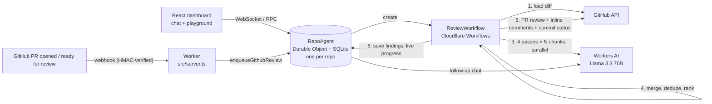

# cf_ai_code_review: AI pull request reviewer on Cloudflare

An AI code reviewer that runs entirely on Cloudflare. When a **non-draft pull request** is opened (or a draft is marked *ready for review*), a GitHub webhook starts a durable **Workflow**. The workflow fetches the diff, runs a deterministic secret scan and four focused **Llama 3.3 70B** analysis passes in parallel, merges and ranks the findings, and posts them back to the PR as **inline review comments** plus a summary. Every review is stored in a per-repository **Durable Object** (Agents SDK). A React dashboard shows live progress, lets you dismiss false positives (remembered for future reviews) and has a **chat** for follow-up questions about the review.

There's also a zero-setup **Playground**: paste a file or a `git diff`, or load one of the deliberately vulnerable samples, and get the same review in the browser.

## See it in action

- **Live app:** https://cf-ai-code-review.bartosz-matyjaszczyk.workers.dev. Open the Playground, click **Load sample**, then **Run review** (no setup needed).
- **Demo repository:** https://github.com/bmatyjaszczyk/cf_ai_code_review-demo. The GitHub App `cf-ai-code-review-bot` is installed there.
- **Example PR reviewed automatically:** https://github.com/bmatyjaszczyk/cf_ai_code_review-demo/pull/1. Look at the bot's inline comments, the summary table and the red "AI code review" status check. Later pushes to the PR were reviewed incrementally.
- **Dashboard for the demo repo:** https://cf-ai-code-review.bartosz-matyjaszczyk.workers.dev/?agent=bmatyjaszczyk--cf_ai_code_review-demo (review history, live progress, findings, chat)

Want to see it react live? Open a non-draft PR against the demo repo. The bot reviews it within about a minute.

## What it catches

| Pass | Covers |
|---|---|
| 🔑 **Secret scan** (deterministic: regex + entropy, no LLM) | Private keys, AWS / Stripe / GitHub / Slack / Google / OpenAI keys, JWTs, DB connection strings with passwords, generic `password = "…"` assignments (placeholders and env lookups ignored) |
| 🛡️ **Security & configuration** | SQL/NoSQL injection, command injection, code and object injection (`eval`, `pickle`, `unserialize`, prototype pollution), XSS, SSRF, path traversal, missing auth/IDOR, weak crypto, CORS `*`, TLS verification off, debug mode, insecure cookies |
| 🐛 **Bugs, concurrency & type safety** | Logic errors, missing `await`, check-then-act races, read-modify-write without a transaction or lock, shared mutable state, language quirks (JS `==`, Python mutable defaults, Go loop capture …), unsafe casts |
| 🐢 **Database & I/O performance** | N+1 queries, missing indexes, unbounded queries, blocking I/O on the request path (`readFileSync`, `time.sleep` in async code), sequential awaits, missing timeouts |
| 💸 **Money math, error handling & quality** | Floats for currency, `toFixed`/`Math.round` rounding, swallowed exceptions, leaking stack traces, unclosed resources, code quality where it matters |

## Architecture



| Assignment requirement | Implementation |
|---|---|
| **LLM** | `@cf/meta/llama-3.3-70b-instruct-fp8-fast` on Workers AI, with JSON-schema structured output, validated and coerced in code (`src/llm.ts`) |
| **Workflow / coordination** | **Cloudflare Workflows** (`src/workflow.ts`): each LLM call is a separately checkpointed step with its own retries and timeout. The webhook returns in milliseconds and the review runs durably in the background. Workflow IDs are derived from the PR head SHA, so redelivered webhooks don't create duplicate reviews |
| **User input (chat)** | React dashboard (`src/client`) served as Workers static assets: chat about each review, the paste-code playground, PR re-runs, team conventions |
| **Memory / state** | **Agents SDK `Agent`** (Durable Object with SQLite, `src/agent.ts`), one per repository: review history, findings, chat transcripts, **dismissed findings** (skipped in all later reviews), **team conventions** (added to every prompt) and which findings were already commented on each PR (not repeated after a push). State syncs live to every open dashboard |

### Design decisions

- **Focused passes rather than one big prompt.** Llama 3.3 does much better with a short checklist per call. Four passes run in parallel as separate workflow steps, so a failure in one is retried without redoing the others.
- **Secrets are found deterministically.** Regexes and an entropy check are more reliable than an LLM for this. LLM findings about the same line are deduplicated against the scanner.
- **The model cites real lines.** The diff is rendered with new-file line numbers (`L42 + code`), and the model is told to report only on added lines. Every cited line is checked against the diff: near-misses are moved to the nearest changed line, and invented lines are dropped. That's what makes inline comments reliable.
- **Stable fingerprints.** A finding's identity is `file + category + content of the cited line`, not the line number and not the model's wording, so dismissals survive code moving around. To avoid repeating comments, an even looser key is used (`file + line content`). Llama doesn't always give the same issue the same category, and a line the bot has already commented on shouldn't get a second comment after a push.
- **Incremental reviews on push.** On `synchronize`, the GitHub compare API finds the files changed since the last reviewed commit. Only those are sent to the LLM. Findings in untouched files are carried over, so the status check still reflects every open issue. After a force-push the comparison fails, and it falls back to a full review.
- **Bounded cost.** Lockfiles, vendored, generated and binary files are skipped. The diff is packed into chunks of ~9k tokens (24k context window), and there are at most 4 chunks per review, so at most 16 LLM calls. Anything not reviewed is listed in the summary.
- **Untrusted model output.** The model reads attacker-controllable code, so its output is never rendered as HTML: the dashboard has its own small markdown-to-React renderer.

## Running it

### Prerequisites

- Node 20+ and a Cloudflare account (Workers AI and Workflows are both on the free plan).
- `npx wrangler login`

### Local development

```bash
npm install
cp .dev.vars.example .dev.vars   # optional: only needed for GitHub integration
npm run dev                       # http://localhost:5173
```

The Playground works with no configuration: open it, click **Load sample**, then **Run review**. Workers AI always runs remotely, so even local dev uses your Cloudflare account.

```bash
npm test          # unit tests (diff parsing, secret scanner, merging, model-output validation, key handling)
npm run typecheck
```

### Deploy

```bash
npm run deploy
```

### Connect GitHub (automatic PR reviews)

1. **Create a GitHub App** (Settings → Developer settings → GitHub Apps → New):
   - Webhook URL: `https://<your-worker>.workers.dev/webhook/github`
   - Webhook secret: a long random string
   - Repository permissions: **Pull requests: Read & write**, **Contents: Read**, **Commit statuses: Read & write**, Metadata: Read
   - Subscribe to events: **Pull request**
2. Generate a private key (`.pem`) and install the app on your repository.
3. Store the credentials as Worker secrets:
   ```bash
   npx wrangler secret put GITHUB_APP_ID
   npx wrangler secret put GITHUB_APP_PRIVATE_KEY   # paste the .pem as is; PKCS#1 is converted in code
   npx wrangler secret put GITHUB_WEBHOOK_SECRET
   npx wrangler secret put DASHBOARD_TOKEN          # optional but recommended: protects repo dashboards
   ```
   *Quicker alternative to an app:* a fine-grained personal access token with *Pull requests: Read & write* (`GITHUB_TOKEN`), plus a repository webhook (content type `application/json`, "Pull requests" events). Comments then appear as your user.
4. Open a non-draft PR. A pending "AI code review" status appears and the review follows in about 30–90 seconds. The dashboard is at `/?agent=<owner>--<repo>`, and every comment links to it.

### Configuration (`wrangler.jsonc` → `vars`)

| Var | Default | Meaning |
|---|---|---|
| `MODEL` | `@cf/meta/llama-3.3-70b-instruct-fp8-fast` | Workers AI model |
| `REVIEW_ON_PUSH` | `true` | Also review new commits pushed to an open PR. Only files changed since the last review are re-reviewed, findings in untouched files are carried over, and lines already commented on aren't commented again |
| `MAX_INLINE_COMMENTS` | `20` | Maximum inline comments per review; the rest go into the summary |
| `MIN_CONFIDENCE` | `0.5` | Drop findings below this model confidence (critical ones are always kept) |

## Project layout

```
src/
  server.ts      Worker: webhook (signature check, draft filter), /api/config, agent routing + auth
  workflow.ts    ReviewWorkflow: durable review pipeline
  agent.ts       RepoAgent: per-repo memory (SQLite) + dashboard RPC + chat
  llm.ts         Analysis passes, prompts, JSON schema, output validation, chat
  diff.ts        Patch parsing, line numbering, file filtering, chunking
  secrets.ts     Deterministic secret scanner
  merge.ts       Dedupe, fingerprints, inline mapping, GitHub markdown
  github.ts      Webhook HMAC, GitHub App JWT (WebCrypto), REST calls
  shared/        Types and samples shared with the UI
  client/        React dashboard
test/            Vitest unit tests
```

## Limitations and next steps

- Only the diff (plus GitHub's 3 lines of context) is reviewed. Issues that depend on code elsewhere in the repo (e.g. a caller that already sanitizes input) can cause false positives. Fetching full files or using a code index (Vectorize) would help.
- Large PRs are capped at 4 chunks (about 36k tokens of diff), and the rest is listed as not reviewed.
- Replying to the bot from inside the PR thread (`issue_comment` events) would bring the chat into GitHub as well.
- The playground has no rate limiting. A public deployment should add Cloudflare Rate Limiting or Turnstile.

## AI assistance

Built with Claude Code. The prompts used are in [PROMPTS.md](PROMPTS.md).
